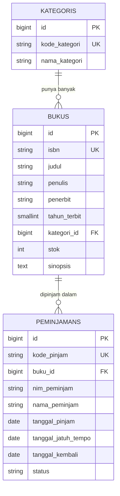
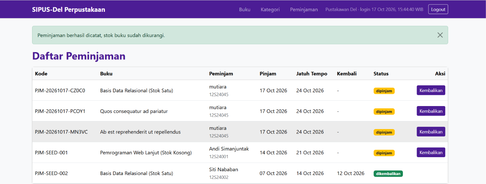
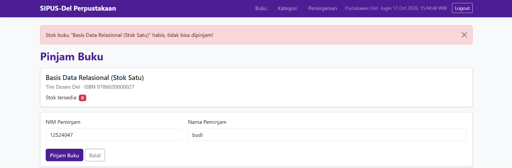
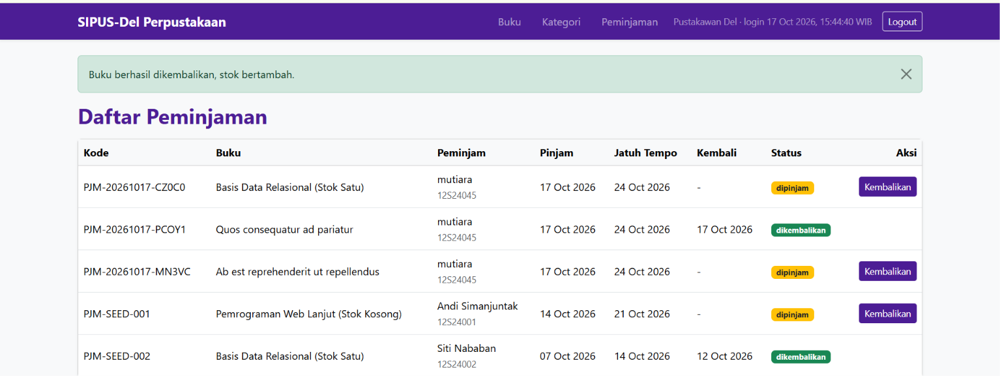
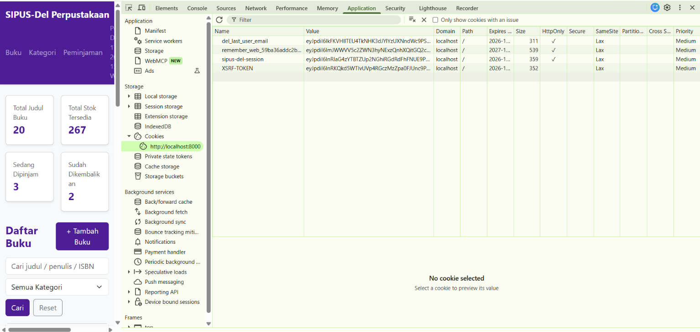
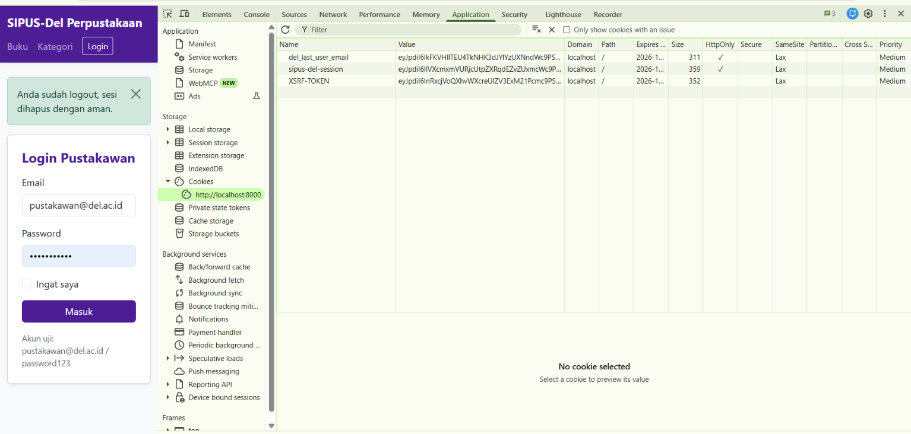
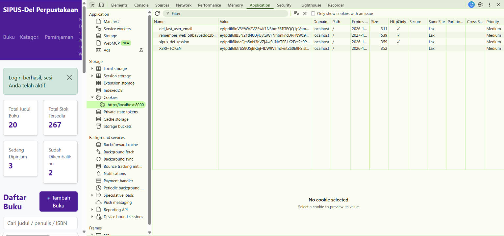

# SIPUS-Del — Sistem Informasi Perpustakaan Kampus Del

Tugas Mandiri Minggu 5 — Pemrograman & Pengujian Web (12S3101)
Institut Teknologi Del

Nama: Mutiara Y.H. Sianturi
NIM:  12S24045

## Deskripsi
Aplikasi web perpustakaan sederhana untuk mengelola data **buku** dan
**kategori**, dibangun dengan pola arsitektur MVC (server-side rendering)
memakai Laravel.

## Fitur
- CRUD Buku dan Kategori memakai `Route::resource` (7 rute per entitas)
- Implicit Route Model Binding
- Relasi Kategori hasMany Buku dan Buku belongsTo Kategori
- Proteksi mass assignment dengan `$fillable`
- Validasi server-side (`$request->validate()`): ISBN unik 13 digit,
  judul minimal 5 karakter, stok minimal 0
- Proteksi CSRF (`@csrf`) dan method spoofing (`@method`) di semua form
- Master layout Blade Component `<x-layout>` bertema Del Purple (#4C1D95)
- Flash message, pagination Bootstrap 5, dan `@forelse` untuk data kosong
- Eager Loading `Buku::with('kategori')` untuk mencegah N+1
- Seeder dan Factory (Faker): 5 kategori dan 20 buku

## Teknologi
Laravel 13, PHP 8.5, SQLite, Bootstrap 5, Blade

Catatan: modul menyebut Laravel 11. Proyek ini memakai Laravel 13 sesuai
arahan dosen. Konsep dan struktur yang dipelajari sama.

## Cara Instalasi
1. `git clone https://github.com/[MutiaraSianturi]/ppw-2026-week5-12S24045.git`
2. `cd ppw-2026-week5-12S24045`
3. `composer install`
4. `copy .env.example .env`
5. `php artisan key:generate`
6. `type nul > database\database.sqlite`
7. `php artisan migrate:fresh --seed`
8. `php artisan serve`, lalu buka http://localhost:8000

## Bukti Audit SQL (Eager Loading)
Kueri dicatat oleh `DB::listen` di `AppServiceProvider` ke
`storage/logs/laravel.log`. Pengujian dilakukan dengan membuka halaman
`/buku` satu kali. File bukti: `docs/audit-eager-loading.log`.

| Kondisi | Jumlah kueri halaman /buku |
|---|---|
| Eager loading `with('kategori')` | 3 |

Penjelasan:
- 1 kueri `count` (dari `paginate()`) untuk menghitung total halaman.
- 1 kueri untuk mengambil 10 buku.
- 1 kueri untuk mengambil semua kategori sekaligus (`where id in (...)`).
- Data buku beserta kategorinya diambil dengan 2 kueri terpadu, bukan satu
  kueri per buku, sehingga tidak terjadi N+1 problem.
- Agar log bersih, session memakai driver `file` (`SESSION_DRIVER=file`)
  sehingga tabel `sessions` tidak muncul di log.

## Struktur MVC
- Model: `app/Models/Buku.php`, `app/Models/Kategori.php`
- View: `resources/views/buku`, `resources/views/kategori`,
  `resources/views/components/layout.blade.php`
- Controller: `app/Http/Controllers/BukuController.php`,
  `app/Http/Controllers/KategoriController.php`
- Route: `routes/web.php`

---

# Minggu 6: Transaksi ACID, Query Builder, Session & Autentikasi

## Akun Uji Pustakawan
| Email | Password |
|---|---|
| pustakawan@del.ac.id | password123 |

## Fitur Minggu 6
- Tabel `peminjamans` dengan foreign key ke `bukus` (`cascadeOnDelete`)
- Peminjaman dan pengembalian memakai `DB::transaction()` + `lockForUpdate()`
- Stok 0 ditolak, NIM yang sama tidak boleh meminjam buku yang sama sebelum mengembalikan
- `QueryException` ditangkap dan dicatat lewat `Log::error()`
- Katalog memakai `with('kategori')->withCount('peminjamans')`, filter `when()`, dan `withQueryString()`
- Kartu statistik memakai `DB::table()`
- Login/logout pustakawan (`Auth::attempt`, `session()->regenerate()`, `invalidate()`, `regenerateToken()`)
- Rute mutasi diproteksi middleware `auth`
- Session: pencarian terakhir, peminjam terakhir, waktu login. Cookie: `del_last_user_email`

## ERD

## Catatan Locking
`lockForUpdate()` menghasilkan `SELECT ... FOR UPDATE` (kunci baris) pada MySQL/InnoDB.
Pada SQLite perintah kunci diabaikan karena SQLite mengunci seluruh database saat proses tulis,
sehingga operasi tetap berurutan. Kode dan logika transaksi sama untuk kedua mesin.

## Bukti Pengujian
**Peminjaman berhasil (stok berkurang)**

**Penolakan saat stok = 0 (rollback)**

**Pengembalian berhasil (stok bertambah)**

**Audit cookie DevTools (HttpOnly, SameSite=Lax)**

**Bukti session()->regenerate(): ID sesi berubah setelah login**

Sebelum login:

Sesudah login:

