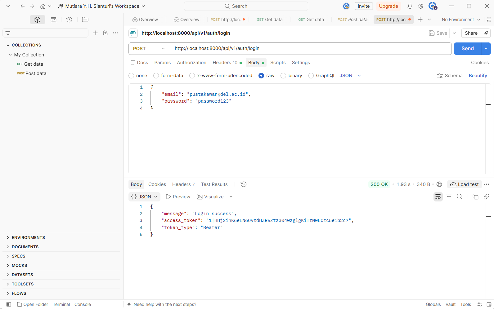
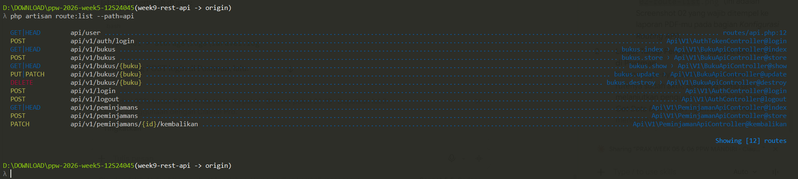
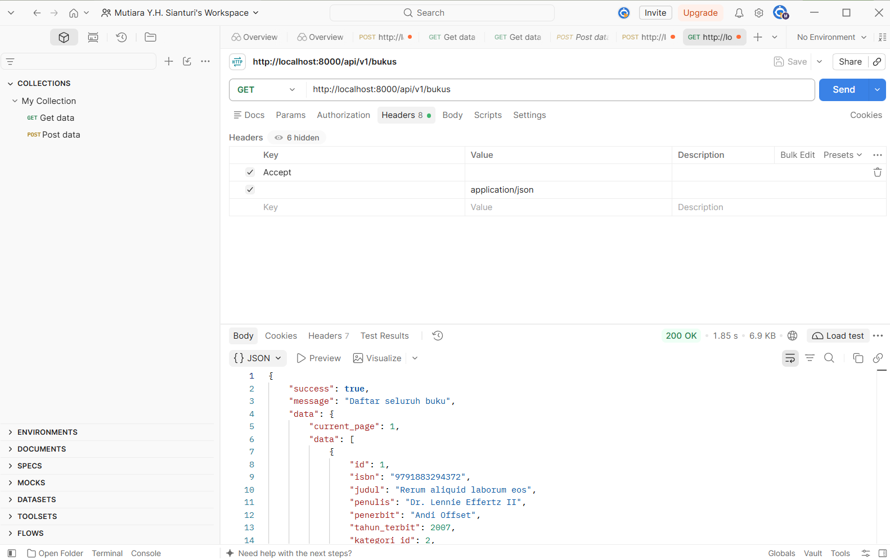
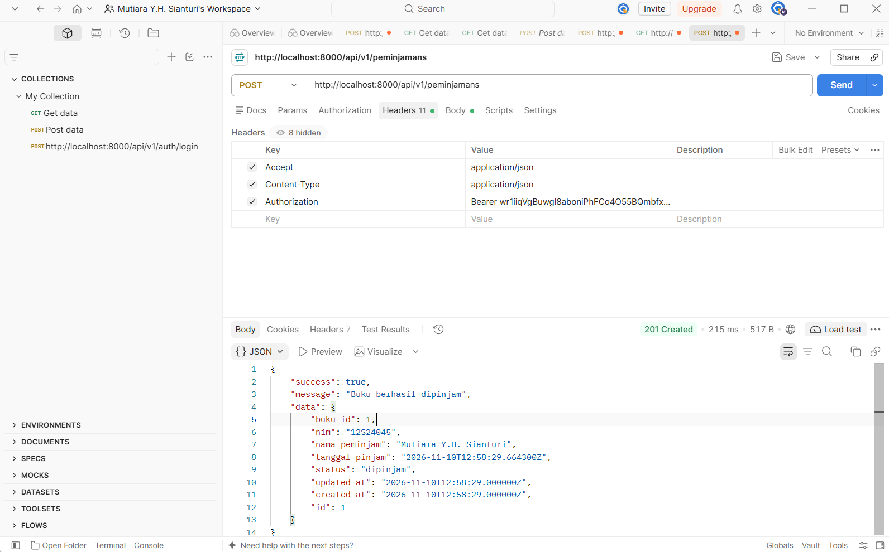
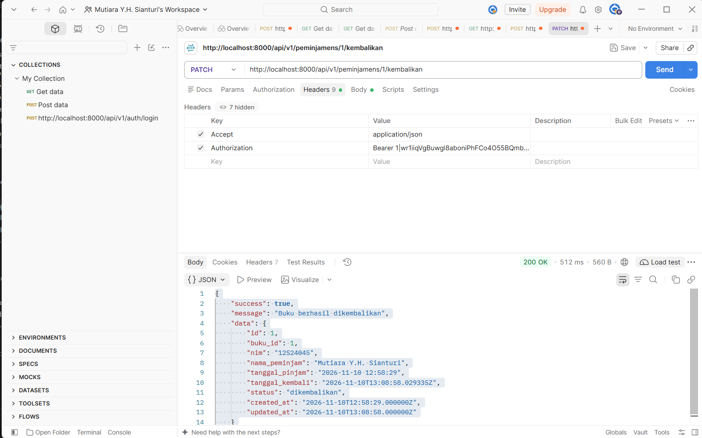

# SIPUS-Del — Sistem Informasi Perpustakaan Kampus Del (Week 9 Web Service & API)

## 1. Identitas Mahasiswa
- **Nama Lengkap**: Mutiara Y.H. Sianturi
- **NIM**: 12S24045
- **Program Studi**: Sistem Informasi (Semester 5)
- **Institut**: Institut Teknologi Del

## 2. Analisis Kebutuhan & Kelayakan Web Services
- **Provider / Consumer Matrix**: SIPUS-Del Laravel backend bertindak sebagai *Provider* (penyedia data buku, autentikasi Sanctum, layanan SOAP), sedangkan Postman atau aplikasi client bertindak sebagai *Consumer*.
- **Komparasi SOAP vs REST**: SOAP menggunakan format XML/WSDL yang kaku dengan standar keamanan ketat (cocok untuk transaksi perbankan/validasi kampus), sedangkan REST API menggunakan format JSON yang ringan, cepat, dan fleksibel untuk web/mobile modern.

## 3. Tabel Katalog Endpoint Web Services
| Method | URI Endpoint | Proteksi Auth | Deskripsi | Kode Status Respons |
| :--- | :--- | :--- | :--- | :--- |
| `GET` | `/soap/sipus.wsdl` | Publik | Mengambil skema WSDL layanan SOAP | `200 OK` |
| `POST` | `/soap/sipus` | Publik | Handler eksekusi request SOAP | `200 OK` |
| `POST` | `/api/v1/login` | Publik | Login untuk mendapatkan Token Sanctum | `200 OK`, `422` |
| `POST` | `/api/v1/logout` | Sanctum Token | Mencabut token akses | `200 OK` |
| `GET` | `/api/v1/bukus` | Publik | Menampilkan daftar seluruh buku | `200 OK` |
| `POST` | `/api/v1/bukus` | Sanctum Token | Menambahkan data buku baru | `201 Created` |
| `POST` | `/api/v1/peminjamans` | Sanctum Token | Transaksi peminjaman buku (ACID) | `201 Created`, `422` |
| `PATCH` | `/api/v1/peminjamans/{id}/kembalikan` | Sanctum Token | Pengembalian buku dan pemulihan stok | `200 OK` |

## 4. Panduan Instalasi & Pengujian Cepat
1. `git clone https://github.com/MutiaraSianturi/ppw-2026-week5-12S24045.git`
2. `cd ppw-2026-week5-12S24045`
3. `git checkout week9-rest-api`
4. `composer install`
5. `copy .env.example .env`
6. `php artisan key:generate`
7. `New-Item -ItemType File -Path "database\database.sqlite"`
8. `php artisan migrate:fresh --seed`
9. `php artisan serve`

## 5. Galeri Bukti Pengujian (Screenshots)
Seluruh skenario pengujian endpoint telah didokumentasikan di folder `docs/screenshots/`:

1. **Screenshot 1: Autentikasi / Login (Mendapatkan Token Sanctum)**
   

2. **Screenshot 2: Daftar Rute Endpoint API (Route List)**
   

3. **Screenshot 3: Endpoint GET Katalog Buku (Public)**
   

4. **Screenshot 4: Endpoint POST Peminjaman Buku**
   

5. **Screenshot 5: Endpoint PATCH Pengembalian Buku**
   